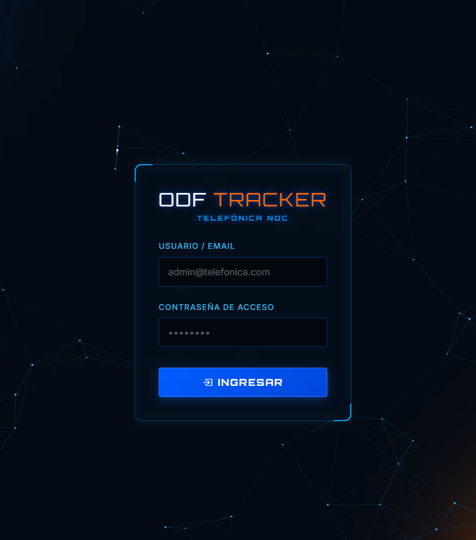
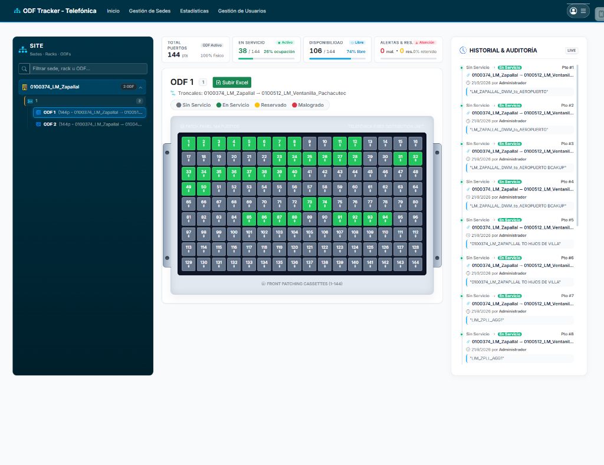
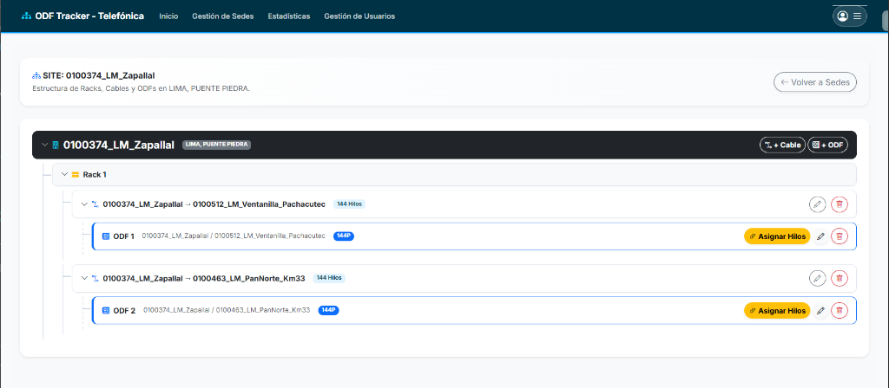
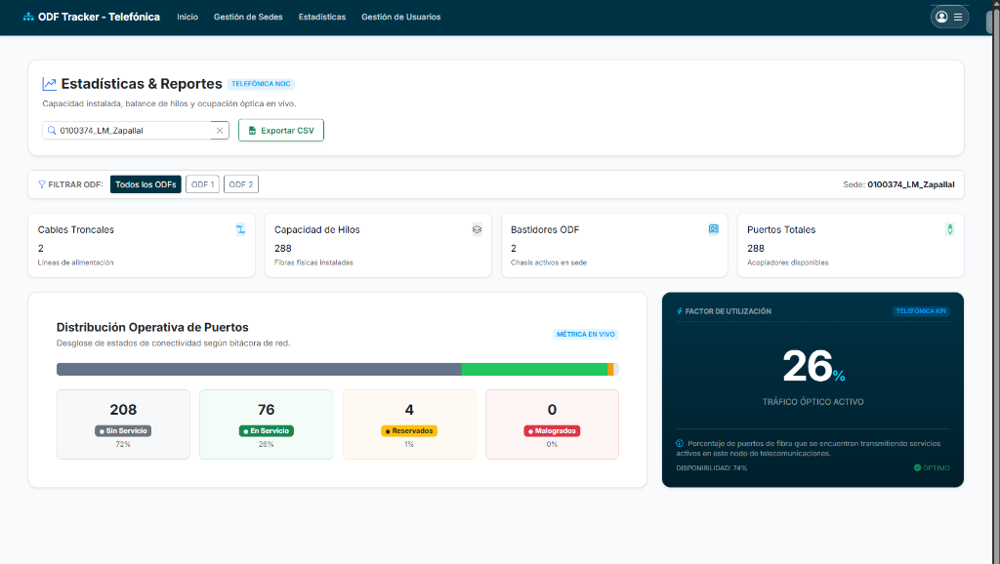

# 📡 ODF Tracker - Telefónica
### Sistema de Gestión, Inventario y Monitoreo de Infraestructura ODF

**ODF Tracker** es una plataforma web desarrollada para la administración visual, control en tiempo real y auditoría operativa de la infraestructura de fibra óptica en centrales y nodos de telecomunicaciones (*Optical Distribution Frames* - ODF).

Permite a técnicos, supervisores y administradores conocer con exactitud el estado de cada conector, cable troncal e hilo de fibra, agilizando las operaciones en campo y centralizando la información técnica.

---

## 📸 Vistas del Sistema

### 1. Acceso Seguro al Sistema (NOC)
Ingreso protegido para el personal técnico y operativo con autenticación basada en roles (`Administrador`, `Supervisor` y `Técnico`).

<p align="center">
  
</p>

---

### 2. Panel Visual Interactivo de ODF y Auditoría en Vivo
Mapeo visual en cuadrícula de los puertos del bastidor (ej. ODF de 144 puertos). Cuenta con códigos de color para identificar el estado de cada hilo al instante, botón de carga masiva con Excel y una bitácora en tiempo real que registra cada cambio realizado.

<p align="center">
  
</p>

---

### 3. Estructura Jerárquica de la Sede
Organización intuitiva de la planta interna de cada sede o nodo de telecomunicaciones: **Sede $\rightarrow$ Rack $\rightarrow$ Cables Troncales (144 hilos) $\rightarrow$ Bastidores ODF**. Permite gestionar y asignar hilos directamente.

<p align="center">
  
</p>

---

### 4. Estadísticas y Reportes en Tiempo Real
Monitoreo de capacidad instalada, balance de hilos y ocupación óptica en vivo. Incluye factor de utilización porcentual, clasificación de estados y botón de exportación rápida a formato CSV.

<p align="center">
  
</p>

---

## 💡 ¿Cómo Funciona para el Usuario?

El flujo de trabajo dentro de **ODF Tracker** está pensado para ser ágil, intuitivo y sin pasos innecesarios:

1. **Ingreso al Sistema:** El usuario inicia sesión según su perfil asignado.
2. **Exploración de Sedes y Racks:** Desde el menú principal, accede a la sede deseada (por ejemplo, *0100374_LM_Zapallal*) para ver qué racks, cables y ODFs están instalados.
3. **Inspección del Bastidor ODF:** Al seleccionar un ODF, se despliega el panel interactivo tipo *patch panel*. Cada puerto muestra su condición mediante colores claros:
   - 🟢 **En Servicio:** Puerto activo con tráfico o servicio cliente asignado.
   - ⚪ **Sin Servicio / Disponible:** Puerto libre listo para ser asignado.
   - 🟡 **Reservado:** Puerto apartado para proyectos o ampliaciones futuras.
   - 🔴 **Malogrado:** Puerto dañado o fibra con atenuación fuera de norma.
4. **Asignación y Modificación de Hilos:**
   - **Individual:** El técnico hace clic en un puerto para cambiar su estado, asociar el servicio de cliente o documentar observaciones.
   - **Masiva:** Con el botón **Subir Excel**, se pueden actualizar decenas o cientos de puertos en un solo paso mediante una plantilla estandarizada.
5. **Auditoría Transparente:** En el panel lateral derecho se observa el historial cronológico con fecha, hora, usuario responsable y el cambio realizado (ej. de *Sin Servicio* a *En Servicio*).
6. **Consultas y Reportes:** En el módulo de estadísticas se filtran los datos por sede o por ODF y se descargan reportes en Excel/CSV con un solo clic.

---

## 🌟 Ventajas y Beneficios

| Beneficio | Descripción |
| :--- | :--- |
| 🚫 **Cero Errores y Cruces de Hilos** | Evita la sobreasignación o desconexión accidental de servicios de clientes gracias a la validación de estados y puertos en tiempo real. |
| ⏱️ **Ahorro de Tiempo en Campo y Central** | Elimina la dependencia de hojas de cálculo desactualizadas o registros en papel; la información está disponible al instante desde cualquier navegador. |
| 🔍 **Trazabilidad y Auditoría Total** | Queda registrado de forma automática quién realizó cada modificación, cuándo se hizo y qué servicio se asignó. |
| 📊 **Planificación y Control de Capacidad** | Conoce con certeza el factor de utilización (porcentaje ocupado vs disponible) para anticipar ampliaciones de red e inversión en nueva fibra. |
| 📥 **Agilidad con Cargas Masivas** | Despliega nuevos proyectos o migraciones de clientes en minutos utilizando archivos Excel/CSV. |
| 📱 **Accesible y Adaptable** | Interfaz optimizada para pantallas táctiles, tablets y computadoras portátiles utilizadas por técnicos en campo. |

---

## ⚙️ Especificaciones Técnicas Básicas

- **Lenguaje:** PHP 8.1 o superior.
- **Base de Datos:** MySQL / MariaDB (con soporte de integridad referencial InnoDB).
- **Servidor Web:** Apache (compatible con XAMPP, WampServer o servidores Linux LAMP).
- **Frontend:** HTML5, CSS moderno y JavaScript nativo optimizado con librerías interactivas (SweetAlert2, Chart.js, DataTables).
- **Seguridad:** Autenticación con contraseñas encriptadas (Bcrypt), tokens de protección CSRF y prevención contra accesos no autorizados.

---

## 🚀 Guía Rápida de Instalación

1. **Descargar el proyecto:**
   ```bash
   git clone https://github.com/kevincusi2010-glitch/inventario_odf.git
   ```
   *(Colocar dentro del directorio web, por ejemplo en `C:\xampp\htdocs\inventario_odf`)*.

2. **Instalar dependencias de Composer:**
   ```bash
   composer install
   ```

3. **Configurar el entorno:**
   Copiar `.env.example` como `.env` y configurar los datos de acceso a MySQL:
   ```bash
   cp .env.example .env
   ```

4. **Importar la Base de Datos:**
   - Crear una base de datos llamada `inventario_odf`.
   - Importar el archivo `database/inventario_odf.sql`.
   - Ejecutar las migraciones:
     ```bash
     php database/migrate.php
     ```

5. **Acceder desde el navegador:**
   - Abrir: `http://localhost/inventario_odf/`

---

## 🔑 Credenciales de Acceso de Prueba

El sistema cuenta con un usuario administrador preconfigurado para pruebas:

- **Usuario / Correo:** `admin@telefonica.com`
- **Contraseña:** `admin123`

---

### 📄 Licencia y Uso
Sistema de uso técnico para la gestión, mantenimiento y monitoreo de infraestructura de fibra óptica y telecomunicaciones.
