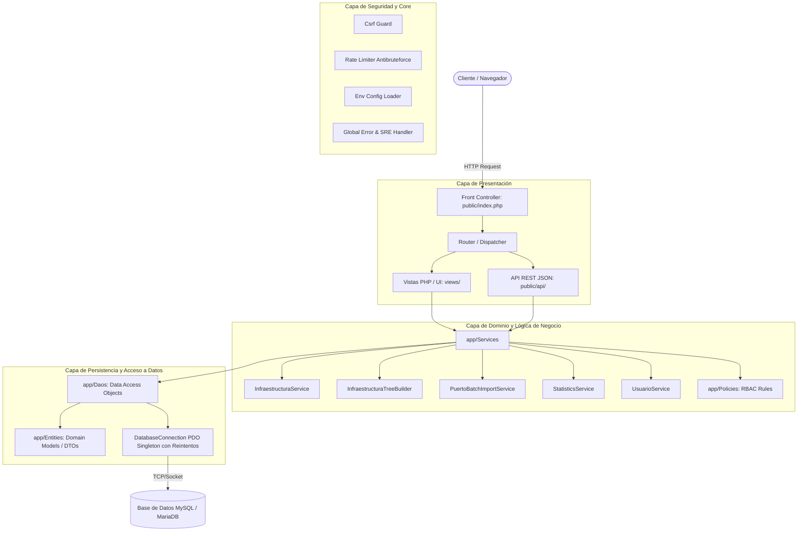
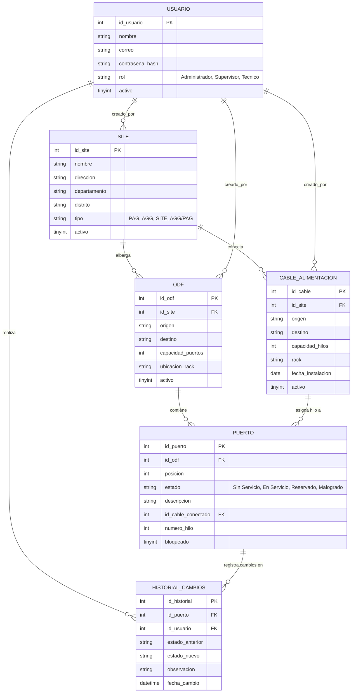

# 📡 Sistema de Inventario y Monitoreo de Infraestructura ODF

[](https://www.php.net/)
[](https://www.mysql.com/)
[](phpunit.xml)
[](app/)
[](app/Core/)

Sistema web integral de alta disponibilidad y trazabilidad para la **gestión, monitoreo, asignación y auditoría de infraestructura óptica** en centrales de telecomunicaciones (Optical Distribution Frames - ODF, Nodos/Sites, Cables troncales y Puertos/Hilos de Fibra Óptica).

Diseñado bajo estándares de ingeniería de software moderna en **PHP 8.1+**, arquitectura limpia por capas (Clean Layered Architecture), resiliencia de conexión a datos y una interfaz visual interactiva y responsiva.

---

## 📑 Tabla de Contenidos

- [🎯 Propósito y Alcance](#-propósito-y-alcance)
- [✨ Características Principales](#-características-principales)
- [🏛️ Arquitectura del Sistema](#️-arquitectura-del-sistema)
- [🗂️ Modelo de Dominio y Entidades](#️-modelo-de-dominio-y-entidades)
- [🛠️ Stack Tecnológico](#️-stack-tecnológico)
- [📋 Requisitos del Sistema](#-requisitos-del-sistema)
- [🚀 Instalación y Puesta en Marcha](#-instalación-y-puesta-en-marcha)
- [🔐 Credenciales de Acceso por Defecto](#-credenciales-de-acceso-por-defecto)
- [🌐 Enrutamiento y Módulos](#-enrutamiento-y-módulos)
- [🔌 Endpoints de la API](#-endpoints-de-la-api)
- [🧪 Pruebas Automatizadas (PHPUnit)](#-pruebas-automatizadas-phpunit)
- [🛡️ Seguridad y Resiliencia](#️-seguridad-y-resiliencia)
- [📁 Estructura del Proyecto](#-estructura-del-proyecto)
- [👥 Control de Versiones y Contribución](#-control-de-versiones-y-contribución)

---

## 🎯 Propósito y Alcance

En redes de fibra óptica a gran escala, la falta de visibilidad en tiempo real del estado de los bastidores ODF, la asignación de hilos y la saturación de cables troncales genera demoras operativas, riesgo de colisiones entre técnicos y falta de auditoría en cambios críticos.

**Inventario ODF** resuelve esta problemática centralizando:
1. **El inventario físico jerárquico:** Sede (Site) $\rightarrow$ Bastidor (ODF) $\rightarrow$ Bandejas y Puertos $\leftrightarrow$ Cables de alimentación (Troncales).
2. **La operación de planta interna y externa:** Asignación, reserva y bloqueo concurrente de hilos de fibra.
3. **La trazabilidad y gobierno de datos:** Bitácora inmutable de cada cambio de estado, servicio asociado, fecha y técnico responsable.

---

## ✨ Características Principales

- 📊 **Dashboard Ejecutivo en Tiempo Real:** 
  - Gráficos interactivos de ocupación y estado de puertos (*En Servicio*, *Sin Servicio*, *Reservado*, *Malogrado*).
  - Distribución de capacidad por sede y saturación de cables de alimentación.
  - Indicadores clave de rendimiento (KPIs) de infraestructura.

- 🏢 **Gestión Jerárquica de Infraestructura:**
  - Administración de Sedes/Nodos (`PAG`, `AGG`, `SITE`, `AGG/PAG`) con ubicación geográfica.
  - Registro de bastidores ODF con especificación de capacidad, racks y destinos.
  - Gestión de troncales de fibra óptica (cables de 48, 96, 144 hilos, etc.).

- 🔍 **Visualizador Interactivo de Racks y Bandejas:**
  - Inspección gráfica de conectores ópticos en tiempo real en la vista de detalle del Site.
  - Identificación por código cromático del estado de cada hilo.

- ⚡ **Operaciones de Asignación y Parcheo:**
  - Asignación rápida de puertos a clientes/servicios de red.
  - Detección y prevención de colisiones en tiempo real.
  - Edición en caliente del estado operativo y notas técnicas.

- 📥 **Carga Masiva de Puertos (CSV / Excel):**
  - Módulo de importación masiva de alta velocidad con procesamiento por lotes.
  - Validación sintáctica y de consistencia relacional fila por fila.
  - Descarga de plantilla oficial estándar preconfigurada.

- 📜 **Historial Completo de Auditoría:**
  - Registro cronológico detallado (`historialcambiospuerto`) de todas las transacciones sobre puertos.
  - Almacena estado previo, nuevo estado, usuario autor, fecha y servicio asignado.

- 🔒 **Control de Acceso Basado en Roles (RBAC):**
  - Perfiles bien definidos: `Administrador`, `Supervisor` y `Técnico`.
  - Políticas de autorización a nivel de servicio y vistas (`Policies`).

- 📈 **Exportación de Reportes:**
  - Generación de reportes analíticos descargables en formato CSV / Excel.

- 🩺 **Healthcheck & Monitoreo Operacional:**
  - Endpoint `/health` con comprobación activa de latencia de base de datos, memoria y configuración de entorno.

---

## 🏛️ Arquitectura del Sistema

El proyecto sigue una arquitectura desacoplada por capas guiada por el estándar **PSR-4**:



---

## 🗂️ Modelo de Dominio y Entidades



---

## 🛠️ Stack Tecnológico

| Capa | Tecnología / Herramienta | Descripción |
| :--- | :--- | :--- |
| **Backend Runtime** | **PHP 8.1+** | Tipado estricto, constructor property promotion, match expressions y funciones nativas modernas. |
| **Arquitectura** | **PSR-4 Autoloading** | Gestión modular de dependencias y namespaces mediante Composer. |
| **Base de Datos** | **MySQL 8.0+ / MariaDB 10.4+** | Motor relacional InnoDB con llaves foráneas, triggers de auditoría e índices optimizados. |
| **Persistencia** | **PDO + Resilient Wrapper** | Conexión PDO con pool de reintentos automáticos ante fallas transitorias de red (`DB_MAX_RETRIES`). |
| **Frontend** | **HTML5 + CSS3 + Vanilla JS** | Renderizado server-side ultrarrápido sin sobrecarga de frameworks SPA pesados. |
| **Componentes UI** | **SweetAlert2, Chart.js, DataTables, FontAwesome** | Experiencia de usuario dinámica con feedback interactivo, ordenamiento y gráficos ejecutivos. |
| **Testing** | **PHPUnit 10** | Suite de pruebas unitarias e integración para DAOs, servicios, reglas de negocio e importadores. |
| **Servidor Web** | **Apache (XAMPP / Standalone)** | Redirección de URL limpia y seguridad perimetral mediante `.htaccess`. |

---

## 📋 Requisitos del Sistema

Antes de iniciar la instalación, verifique contar con:

- **PHP:** Versión `8.1.0` o superior (con extensiones activas: `pdo_mysql`, `mbstring`, `json`, `session`).
- **Base de Datos:** MySQL `5.7+` o MariaDB `10.4+`.
- **Gestor de Paquetes:** [Composer](https://getcomposer.org/) v2.x.
- **Servidor Web:** Apache con módulo `mod_rewrite` activado (recomendado: entorno integrado como XAMPP, Laragon o Docker LAMP).

---

## 🚀 Instalación y Puesta en Marcha

### 1. Clonar el Repositorio

```bash
git clone https://github.com/kevincusi2010-glitch/inventario_odf.git
cd inventario_odf
```

*(En un entorno XAMPP típico en Windows, la ruta usual de instalación es `C:\xampp\htdocs\inventario_odf`)*.

---

### 2. Instalar Dependencias de Composer

Ejecute en la raíz del proyecto:

```bash
composer install --no-dev --optimize-autoloader
```
*(Si va a ejecutar pruebas o desarrollar, omita `--no-dev` para incluir PHPUnit).*

---

### 3. Configuración del Entorno (`.env`)

Copie el archivo de ejemplo y ajuste las credenciales según su base de datos local:

```bash
cp .env.example .env
```

Contenido representativo de `.env`:
```ini
APP_ENV=local
APP_DEBUG=true

# Conexión a Base de Datos MySQL
DB_HOST=127.0.0.1
DB_PORT=3306
DB_DATABASE=inventario_odf
DB_USERNAME=root
DB_PASSWORD=
DB_CHARSET=utf8mb4

# Parámetros de Resiliencia SRE
DB_MAX_RETRIES=3
DB_RETRY_DELAY_MS=200
```

---

### 4. Inicializar la Base de Datos

1. Abra su gestor de base de datos preferido (phpMyAdmin, MySQL Workbench, DBeaver o terminal).
2. Cree la base de datos `inventario_odf`:
   ```sql
   CREATE DATABASE inventario_odf CHARACTER SET utf8mb4 COLLATE utf8mb4_unicode_ci;
   ```
3. Importe el esquema base y los datos iniciales desde el archivo SQL provisto:
   ```bash
   mysql -u root -p inventario_odf < database/inventario_odf.sql
   ```
4. Aplique las migraciones incrementales automáticas:
   ```bash
   php database/migrate.php
   ```

---

### 5. Iniciar y Probar la Aplicación

Inicie los servicios de **Apache** y **MySQL** en su panel de control (por ejemplo, Panel de XAMPP).

Abra su navegador web e ingrese a:
- 👉 **`http://localhost/inventario_odf/`**

El sistema redirigirá de manera transparente y segura a la pantalla de autenticación en `public/index.php`.

---

## 🔐 Credenciales de Acceso por Defecto

El esquema incluye un usuario administrador preconfigurado para pruebas inmediatas:

| Rol | Correo Electrónico | Contraseña por Defecto |
| :--- | :--- | :--- |
| **Administrador** | `admin@telefonica.com` | `admin123` |

> 💡 **Nota de Seguridad:** Para los nuevos usuarios que se registren desde el panel de administración, la contraseña inicial automática es `telefonica123`. Se recomienda cambiar las credenciales al implementar en ambientes de producción.

---

## 🌐 Enrutamiento y Módulos

El Front Controller (`public/index.php`) resuelve las siguientes rutas seguras:

| Ruta | Módulo | Acceso Mínimo | Descripción |
| :--- | :--- | :--- | :--- |
| `/login` | Autenticación | Público | Formulario de acceso seguro con token CSRF y protección anti fuerza bruta. |
| `/dashboard` | Monitoreo | Técnico | Panel principal con métricas generales, KPIs y gráficos de ocupación. |
| `/admin/infraestructura` | Infraestructura | Supervisor | Catálogo general de Sites, ODFs y Cables de alimentación. |
| `/admin/site_detalle` | Vista Detalle Site | Técnico | Mapa visual e interactivo de bandejas, racks y puertos del Site. |
| `/operaciones/asignar_hilos` | Operaciones | Técnico | Panel de parcheo, asignación de hilos y actualización de servicios. |
| `/operaciones/estadisticas` | Estadísticas | Supervisor | Reportes analíticos con filtros avanzados y exportación a Excel/CSV. |
| `/admin/usuarios` | Administración | Administrador | Gestión de usuarios, perfiles RBAC, altas, bajas y cambios de estado. |
| `/logout` | Sesión | Autenticado | Cierre de sesión seguro y destrucción de cookies de autenticación. |

---

## 🔌 Endpoints de la API

La aplicación expone una API interna JSON bajo `public/api/` para operaciones asíncronas seguras:

| Método | Endpoint | Parámetros Clave | Descripción |
| :---: | :--- | :--- | :--- |
| `GET` | `/health` | Ninguno | Comprueba el estado de la base de datos, memoria y disponibilidad del entorno. |
| `POST` | `/api/auth_login.php` | `correo`, `password`, `csrf_token` | Autenticación de usuario con rate-limiting en servidor (máx 5 intentos / 10 min). |
| `POST` | `/api/crud_infraestructura.php` | `accion`, `tipo`, `datos...`, `csrf_token` | Operaciones CRUD sobre Sites, ODFs y Cables de Alimentación. |
| `POST` | `/api/update_puerto.php` | `id_puerto`, `estado`, `descripcion`, `csrf_token` | Actualización de estado de puerto con registro automático en historial. |
| `POST` | `/api/crud_asignar_hilos.php` | `id_puerto`, `id_cable`, `numero_hilo` | Vinculación directa de hilos troncales a puertos ópticos. |
| `POST` | `/api/carga_masiva_puertos.php` | `archivo_csv`, `id_odf`, `csrf_token` | Procesamiento e importación en bloque de puertos desde CSV. |
| `GET` | `/api/get_bandeja.php` | `id_odf`, `bandeja` | Obtención en formato JSON de los puertos de una bandeja específica. |
| `GET` | `/api/exportar_estadisticas.php` | `formato`, `filtro_site` | Generación y descarga al vuelo del archivo de estadísticas. |
| `POST` | `/api/crud_usuarios.php` | `accion`, `id_usuario`, `rol`, etc. | Gestión de cuentas y asignación de permisos RBAC. |

---

## 🧪 Pruebas Automatizadas (PHPUnit)

El proyecto cuenta con una batería de pruebas automatizadas que verifican la integridad de los DAOs, la lógica de negocio en Services, los constructores de árboles jerárquicos y las políticas de acceso.

Para ejecutar la suite de pruebas completa:

```bash
# Con PHP en el PATH
vendor/bin/phpunit

# O utilizando la ruta directa de PHP en Windows/XAMPP
C:\xampp\php\php.exe vendor/bin/phpunit
```

### Resultado esperado:
```text
PHPUnit 10.5.66 by Sebastian Bergmann and contributors.

Runtime:       PHP 8.1.25
Configuration: C:\xampp\htdocs\inventario_odf\phpunit.xml

................................                                  32 / 32 (100%)

Time: 00:00.163, Memory: 10.00 MB

OK (32 tests, 128 assertions)
```

---

## 🛡️ Seguridad y Resiliencia

El sistema implementa medidas de ciberseguridad y confiabilidad operacional en cumplimiento con las mejores prácticas de la industria:

1. **Defensa en Profundidad HTTP:**
   - Cabeceras de seguridad estrictas inyectadas en todas las respuestas: `X-Frame-Options: SAMEORIGIN`, `X-Content-Type-Options: nosniff`, `Referrer-Policy: strict-origin-when-cross-origin`, `X-XSS-Protection: 1; mode=block`.
2. **Mitigación de Ataques de Fuerza Bruta:**
   - Límite de tasa (*Rate Limiting*) en el inicio de sesión: tras 5 intentos fallidos por IP en un período de 10 minutos, el acceso se bloquea temporalmente.
3. **Protección Anti-CSRF:**
   - Validación obligatoria de tokens criptográficos temporales en todas las solicitudes `POST`.
4. **Prevención de Inyección SQL:**
   - 100% de las consultas a base de datos están parametrizadas con sentencias preparadas en PDO.
5. **Endurecimiento de Sesiones:**
   - Cookies de sesión configuradas con flags `HttpOnly`, `SameSite=Lax` y modo estricto (`use_strict_mode = 1`). Regeneración automática del Session ID tras el login para neutralizar ataques de fijación de sesión (*Session Fixation*).
6. **Almacenamiento Criptográfico de Contraseñas:**
   - Hasheo robusto mediante el algoritmo nativo `BCRYPT` con costo computacional adaptable.
7. **Resiliencia ante Fallos de Conexión (SRE):**
   - La clase `DatabaseConnection` incorpora un algoritmo de reintentos escalonados con retardo exponencial configurable (`DB_MAX_RETRIES`), protegiendo el sistema de caídas intermitentes o reinicios breves del servidor MySQL.

---

## 📁 Estructura del Proyecto

```plaintext
inventario_odf/
├── app/
│   ├── bootstrap.php                 # Inicializador PSR-4, .env, errores y alias globales
│   ├── Contracts/                    # Interfaces de DAOs y contratos de arquitectura
│   ├── Core/                         # Componentes centrales (Csrf, DatabaseConnection, Env, ErrorHandler)
│   ├── Daos/                         # Implementaciones de acceso a datos MySQL (Sites, ODFs, Cables, Puertos)
│   ├── Entities/                     # Entidades puras de dominio / DTOs (Site, Odf, Puerto, Cable, Usuario)
│   ├── Policies/                     # Lógica de autorización y permisos por rol (RBAC)
│   └── Services/                     # Servicios de lógica de negocio, árbol jerárquico e importación
├── config/
│   └── database.php                  # Acceso centralizado a la instancia PDO compartida
├── database/
│   ├── inventario_odf.sql            # Script DDL/DML de inicialización y datos base
│   ├── migrate.php                   # Ejecutor CLI de migraciones idempotentes
│   └── migrations/                   # Scripts SQL de migraciones versionadas
├── plantillas/
│   └── plantilla_carga_masiva_puertos.csv # Plantilla modelo para importación por lotes
├── public/                           # Directorio expuesto públicamente (DocumentRoot)
│   ├── .htaccess                     # Reglas de reescritura de URL y seguridad
│   ├── index.php                     # Front Controller y despachador de rutas
│   ├── api/                          # Endpoints REST JSON para consumo AJAX
│   └── assets/                       # Hojas de estilo CSS, librerías y scripts JavaScript
├── tests/
│   ├── Unit/                         # Pruebas unitarias (Core, Daos, Policies, Services)
│   └── Integration/                  # Pruebas de integración de base de datos
├── views/                            # Vistas y componentes de interfaz de usuario
│   ├── admin/                        # Vistas de gestión de infraestructura, usuarios y detalle de site
│   ├── auth/                         # Formulario de autenticación (login)
│   ├── dashboard/                    # Panel principal con gráficas y KPIs
│   ├── layouts/                      # Plantillas base, cabeceras, navegación y pies de página
│   └── operaciones/                  # Asignación de hilos y módulo de estadísticas
├── .env.example                      # Plantilla de variables de entorno
├── composer.json                     # Definición del paquete y configuración de autoloading
├── phpunit.xml                       # Configuración de pruebas automatizadas
└── README.md                         # Documentación oficial del repositorio
```

---

## 👥 Control de Versiones y Contribución

1. Bifurque (*Fork*) el repositorio.
2. Cree una rama descriptiva para su funcionalidad (`git checkout -b feature/nueva-funcionalidad`).
3. Asegúrese de que todas las pruebas pasen (`vendor/bin/phpunit`).
4. Realice sus confirmaciones siguiendo convenciones de commits claros (`git commit -m 'feat: agregar soporte para ODF 288 puertos'`).
5. Envíe sus cambios a su repositorio remoto (`git push origin feature/nueva-funcionalidad`).
6. Abra un **Pull Request** para revisión técnica.

---

### 📄 Licencia

Este proyecto es propiedad del equipo de desarrollo de infraestructura. Uso autorizado para la gestión, mantenimiento y monitoreo de redes de telecomunicaciones.
